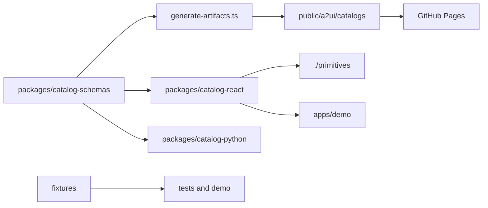

# AI37 A2UI Catalog

<!-- ai37:card:start (managed by doc-bot — do not edit inside) -->
# ai37-a2ui-catalog

## Описание

Монорепозиторий каталога A2UI для экосистемы AI-37: канонические Zod-схемы компонентов, React-рендереры, Pydantic-модели валидации, общие фикстуры и тесты; артефакты каталога публикуются на GitHub Pages и используются для отрисовки и валидации A2UI-сообщений. В составе — доменные карточки результатов расчётов (`ThermalReport`, `LiftReport`, `KeoReport`, `InsolationReport`), редакторы исходных данных (`ConstructionsEditor`/`ConstructionsEditorNext`, `LiftEditor`/`LiftEditorNext`, `KeoEditor`/`KeoEditorNext`, `InsolationEditor`), карточка артефакта агента (`ArtifactCard`), отчёт проверки контрагента (`VerificationReport`), выбор вложения (`AttachmentChoiceCard`) и карточка подтверждения пачки предложений агента (`ProposalCard`, 0.43.0). Есть набор переиспользуемых UI-примитивов (`@ai37/a2ui-catalog-react/primitives`), на котором собраны Next-версии рендереров.

`ArtifactCard` — карточка результата хода, сохранённого в выходной полке chat-backend (`/api/artifacts`): имя, мета и меню «Скачать» (Word/Markdown и бинарные файлы), а «Сохранить в проект» — вызов хоста, а не A2UI-действие агенту. С 0.39.1 то же сохранение доступно пунктом меню «Скачать» у отчётов расчётов, когда их `protocol.downloadUrl` ведёт на артефакт. С 0.39.2 каталог умеет режим «только чтение» для прошлых поверхностей ленты: `SurfaceReadOnlyProvider readOnly` глушит ввод, но оставляет рабочими «Скачать», «Сохранить в проект» и ссылки. С 0.39.3 состояние «Сохранить в проект» привязано к `artifactId`, а меню Next-отчёта по клику «Сохранить в проект» не закрывается.

## Стек

TypeScript, React 19, Zod (zod-to-json-schema), @a2ui/react / @a2ui/web_core (overrides: 0.10.1), @base-ui/react ^1.7.0 (поведение UI), katex, Vite, Vitest, tsup, tsx, Python 3.13+ + Pydantic (диапазон `pydantic>=2.11.7,<3.0.0`; в `uv.lock` зафиксированы pydantic 2.12.5 и pydantic-core 2.41.5), Poetry 2.3.2, Twine, pnpm (>=10, packageManager pnpm@10.29.3), Node >=22. Версия пакетов workspace — 0.43.0 (`package.json`, `apps/demo/package.json`, `packages/catalog-schemas/package.json`, `packages/catalog-react/package.json`, `packages/catalog-python/pyproject.toml`, `packages/catalog-python/uv.lock`). Публикация пакетов — в приватные реестры AI-37 (npm.app.sp-ai.ru и pypi.app.sp-ai.ru). Константы дебаунса автодрафта условий: `CONDITIONS_DRAFT_DEBOUNCE_MS = 500` мс (@ai37/a2ui-catalog-react), `LIFT_DRAFT_DEBOUNCE_MS = 500` мс.

## Схема работы

Workspace состоит из пакетов:
- packages/catalog-schemas — канонические Zod-схемы, метаданные каталога, генерация JSON Schema и артефактов каталога;
- packages/catalog-react — React-рендереры и регистрация компонентов в каталоге; подпуть экспорта `./primitives` — набор примитивов каталога: токены слоями (`--a2ui-text-*`, `--a2ui-btn-*`, `--a2ui-card-*`), `Button`, `Card`, `Chip` (в т.ч. `tone="warning"` и `tone="neutral"`), три ступени текста, `Form`/`Field`/`Input`/`Static`, обёртки над Base UI (`Lookup` на `Autocomplete`, `Select`, `NumberField`, `Menu` с `trigger="link"` и `side="top"`), `SectionItem`, `SummaryCollapsible`, `Combo`, `SourceNote`, `KitStyles`, а также примитивы отчётов: `ReportRow`, `DataChip`, `StatusPill`, `ReportHeadline` (ступень `display` с осью `--a2ui-font-serif`), `ReportTable`, `ReportNote`, `ReportProtocolCard`; пункт меню (`MenuItem`) несёт `disabled`, `tone` и `keepOpen` — при `keepOpen` меню не закрывается по клику (`closeOnClick={false}`); корень набора — класс `a2ui-kit`, пороги колонок `FORM_TWO_COLUMNS_AT = 500`, `FORM_THREE_COLUMNS_AT = 620`;
- packages/catalog-python — Pydantic-модели и валидация на стороне Python;
- apps/demo — Vite-приложение для ручной проверки A2UI-сообщений; витрина примитивов — `/proba/system`;
- fixtures — общие валидные, невалидные и сквозные фикстуры сообщений.

Поток данных: схемы → generate-artifacts.ts → catalog.json и component schemas → public/a2ui/catalogs → GitHub Pages. React-рендереры и Pydantic-модели подключаются к тем же компонентам; тесты и демо используют фикстуры.

Режим «только чтение» прошлой поверхности (0.39.2):
- хост ленты держит редактируемой только последнюю поверхность (`isLive`), а прежние оборачивает в `SurfaceReadOnlyProvider readOnly={!isLive}`; каталог сам делит интерактив по смыслу. Модуль — `renderers/surface-read-only.tsx`: контекст `SurfaceReadOnlyContext` (`boolean | undefined`), провайдер `SurfaceReadOnlyProvider({readOnly, children})`, хук `useSurfaceReadOnly()` (true только при значении `true` из провайдера; без провайдера — false) и HOC `withReadOnlyGate(impl)`;
- компоненты ввода глушатся целиком: `withReadOnlyGate` оборачивает `ChoiceCard`, `AttachmentChoiceCard`, `FormCard`, `ConstructionsEditor`, `ConstructionsEditorNext`, `LiftEditor`, `LiftEditorNext`, `KeoEditor`, `KeoEditorNext`, `InsolationEditor` и базовые компоненты `basicCatalog` из набора `BASIC_INPUT_COMPONENTS` (`Button`, `TextField`, `CheckBox`, `ChoicePicker`, `Slider`, `DateTimeInput`). Поддерево получает атрибут `inert` — ни клика, ни фокуса, ни клавиатуры; обёртка (`
`) стоит под провайдером всегда, меняется только атрибут, поэтому переход «живая → прошлая» не перемонтирует форму и введённое не теряется; `data-a2ui-read-only` — крючок для стилей хоста; без провайдера рендер прежний, обёрток нет;
- кнопки действий отчёта, уходящие агенту («Пересчитать», «Изменить и пересчитать»), на прошлой поверхности не рендерятся (`useSurfaceReadOnly()` → `null`): `ReportNextActionButton` и кнопки старых `LiftReport`, `ThermalReport`, `KeoReport`, `InsolationReport`;
- меню «Скачать» (и Next-меню, и `
`), «Сохранить в проект», ссылки, раскрытие протокола и секций отчёта, `ArtifactCard`, `VerificationReport`, `ProposalCard` и таблицы (`SimpleTable`, `FlexTable`) остаются рабочими — они не оборачиваются;
- экспорт из `@ai37/a2ui-catalog-react`: `SurfaceReadOnlyProvider`, `useSurfaceReadOnly`, `withReadOnlyGate` (для хостов, собирающих свой каталог).

Доменные компоненты (catalog v2, набор расширяется аддитивно):
- отчёты: `ThermalReport`, `LiftReport`, `KeoReport`, `InsolationReport` — вердикт, рекомендации/проверки, исходные данные по источникам, протокол; для `ThermalReport` и `LiftReport` рядом зарегистрированы `ThermalReportNext`/`LiftReportNext` на наборе примитивов — те же схемы props и тот же контракт действий (`{event: {name, context: payload ?? {}}}`), своих листов стилей у них нет;
- редакторы: `ConstructionsEditor` (+ `ConstructionsEditorNext`), `LiftEditor` (+ `LiftEditorNext`), `KeoEditor`/`KeoEditorNext`, `InsolationEditor` — один submit с документом, live-черновик с дебаунсом, индикация без блокировки; Next-версии построены на примитивах и регистрируются рядом со старыми для сравнения «было/стало»;
- `ArtifactCard` (0.39.0) — карточка артефакта агента;
- `VerificationReport` (0.40.0) — вердикт проверки контрагента;
- `AttachmentChoiceCard` (0.41.0) — выбор «продолжить без файла / с файлом»;
- `ProposalCard` (0.43.0) — подтверждение пачки предложений агента данных.

`ArtifactCard` (0.39.0):
- контракт — `artifactCardPropsSchema` (strict): обязательны `artifactId` (uuid-паттерн) и `name` (1..200); опциональны `kind` (1..64), `meta` (1..200), `summary` (1..500), `scope` (`chat` | `project`), `formats` (массив `'docx'`/`'md'`, максимум 2) и `files` (массив `{id, fileName (1..255), label? (1..80)}`, максимум 20). Паттерн, а не `z.string().uuid()`, — чтобы JSON Schema получила `pattern`, один в один повторяющий Pydantic-зеркало; href в props нет вовсе. Python-зеркало — `models/artifact_card.py` (`ArtifactCardProps`, `ArtifactCardFile`, `ArtifactCardFormat`, `ARTIFACT_ID_PATTERN`), `ArtifactCard` в `COMPONENT_MODELS`;
- рендерер `renderers/artifact-card.tsx` — `createComponentImplementation(artifactCardDefinition, …)`, экран вынесен отдельно (`renderers/artifact-card-screen.tsx`) на примитивах набора: одна строка `ReportProtocolCard` с именем, метой и действиями справа; меню «Скачать» (`Menu side="top"`) есть только когда есть пункты;
- ссылки — `renderers/artifact-card-links.ts`: база по умолчанию `DEFAULT_ARTIFACTS_BASE_URL = '/api/artifacts'`, хост может задать свою только путём от корня (`safeArtifactsBaseUrl`); пункты меню — `<base>/<artifactId>/content?format=docx|md` и `<base>/<artifactId>/files/<fileId>`;
- «Сохранить в проект» — вызов хоста, а не A2UI-действие агенту; хост передаёт `baseUrl` и `onSaveToProject` через `ArtifactCardHostProvider` (`renderers/artifact-card-host.tsx`, `useArtifactCardHost`); состояния ведёт общий хук `renderers/use-save-to-project.ts` (`useSaveToProject`), привязанный к `artifactId`;
- регистрация: `CATALOG_COMPONENT_NAMES` и `catalog.ts` в catalog-schemas (`artifactCardDefinition`), `catalog.ts` в catalog-react, `COMPONENT_MODELS` в catalog-python. `CATALOG_VERSION` остаётся `v2`.

`ProposalCard` (0.43.0, change `proposal-card`, план AI-37/docs#545 §3.7/§3.9):
- контракт — `proposalCardPropsSchema` (strict, `components/proposal-card.ts`): обязательны `proposalId` (1..200), `title` (1..120), `state` (`open` | `accepted` | `rejected` | `superseded`) и `items` (1..50); опциональны `view` (`list` | `table`), `source` (`{label? 1..120, quote 1..1000}`), `note` (1..400), `confirm` (`{label 1..80, action 1..120}`), `canDecide` (boolean) и `decideLink` (`{label 1..120, href 1..2000}`). Пункт пачки `items[]` — `{id 1..120, kind: added|changed|removed, label 1..200, before? 1..200, after? 1..200, effectiveFrom? 1..40, status?: pending|accepted|rejected|stale}`; значения приходят готовыми строками, рендерер их не форматирует. Python-зеркало — `models/proposal_card.py` (`ProposalCardProps`, `ProposalItem`, `ProposalSource`, `ProposalConfirm`, `ProposalDecideLink`, `ProposalCardState`, `ProposalItemStatus`, `ProposalItemKind`, `ProposalCardView`), `ProposalCard` в `COMPONENT_MODELS`;
- рендерер `renderers/proposal-card.tsx` — `createComponentImplementation(proposalCardDefinition, …)`; `useA2uiBaseStyles()`, `useSurfaceReadOnly()`, локальный `sent`. Экран вынесен отдельно (`renderers/proposal-card-screen.tsx`) и собран на примитивах набора (`Card`, `Card flat`, `CardHeader`, `StatusPill`, `Button` `filled lg`, `buttonClassName`, классы `a2ui-table`, токены `--a2ui-card-surface-sunken`/`--a2ui-card-radius-sunken`); новых примитивов нет;
- шапка: заголовок и пилюля состояния, слово пишет рендерер (`renderers/proposal-card-state.tsx`): `open` — «ждёт подтверждения» (`warning`), `accepted` — «подтверждено» (`pass`), `rejected` — «отклонено» (`fail`), `superseded` — «заменено» (`neutral`); у заменённой пачки блок пунктов приглушён (`a2ui-t--muted`) целиком;
- пункты: при `view: 'list'` (или без `view`) — `renderers/proposal-card-list.tsx` строками «новое / изменено / удалено» (`proposal-card-list-row.tsx`, значение собирает `renderers/format-proposal-item-value.ts`: `было → станет`, иначе одно значение, дата хвостом «с 01.11.2026»); при `view: 'table'` — `renderers/proposal-card-table.tsx` с колонками «Что · Было · Станет»; колонка «С какой даты» появляется, только если `effectiveFrom` есть хотя бы у одного пункта; пустое «Станет» у `removed` печатается как «удалено»;
- статус пункта (`renderers/proposal-card-item-status.tsx`): `accepted` — «принято» (`pass`), `rejected` — «отклонено» (`fail`), `stale` — «устарело» (`warning`); `pending` и отсутствие статуса пилюли не дают;
- источник — `renderers/proposal-card-source.tsx`: цитата и подпись на утопленном фоне; заметка — приглушённая строка под пунктами;
- подвал считает чистая функция `renderers/resolve-proposal-card-footer.ts` (`resolveProposalCardFooter(props, readOnly)` → `'confirm' | 'link' | 'none'`): решённая или заменённая пачка (`state !== 'open'`) и `canDecide: false` дают `none`; `confirm` при живой (не read-only) поверхности — кнопку; иначе `decideLink`, если адрес безопасный (`renderers/is-proposal-decide-href.ts`: путь от корня хоста `/…` без `//` и без бэкслеша либо `http(s)://`; `javascript:` и `//чужой-хост` не рисуются);
- «Подтвердить» один раз диспатчит `confirm.action` с контекстом `{proposalId, decision: 'accept'}`; после клика кнопка гаснет (`sent`), второй клик не диспатчит. Ссылка `decideLink` — обычный `<a>`, а не кнопка;
- карточка НЕ обёрнута `withReadOnlyGate`: на прошлой поверхности кнопку прячет сам рендерер, а ссылка на «Требуют решения» остаётся рабочей;
- регистрация: `CATALOG_COMPONENT_NAMES` и `catalog.ts` в catalog-schemas (`proposalCardDefinition`), `catalog.ts` в catalog-react (`customComponents`), `COMPONENT_MODELS` и `__init__` в catalog-python; `CATALOG_VERSION` остаётся `v2`; артефакты `public/` перегенерированы (`export:public`).

Правило зависимостей лифтов умеет ставить подпись под полем (0.37.0, change `lift-editor-note-rules`): строка `dependentRules[].rows[]` получила опциональный `note: {field, text (1–160), tone?: 'muted' | 'warning'}` (`tone` по умолчанию `warning`), а `set` стал опциональным; строка без `set` и без `note` отвергается схемой. Совпадение считается как у `set` — первая строка правила, чей `when` совпал со значениями `sources` в порядке объявления (числа сравниваются численно), в том числе кросс-секционно (`scope: 'building'`). Подписи собирает `collectRuleNotes(rules, building, lift)` из ТЕКУЩИХ значений секции лифта после подстановок; на одно поле побеждает первое правило, внутри правила — первая совпавшая строка. Оба рендерера (`LiftEditor` и `LiftEditorNext`) показывают подпись с приоритетом note → источник → hint. `collectRuleTargets` и `applyDependentRules` читают `row.set ?? {}`.

Вид слоя `thin` и толщина у зазоров (0.38.0, change `constructions-layer-kind-thin`):
- `constructionLayerKindSchema` принимает `thin` — тонкий нетепловой слой: λ не бывает, Rs = 0 считает сервер; Python-зеркало — `ConstructionLayerKind = Literal["material", "vent-gap", "closed-gap", "thin"]`;
- форма слоя `ConstructionsEditorNext` получила селектор «Вид слоя» (`ConstructionsNextKindField` поверх `Field` + `Select`); подписи и пункты — `LAYER_KIND_LABELS` / `LAYER_KIND_ITEMS` (`layer-kind-labels.ts`). Смена вида на не-материал снимает `materialKey`, `lambdaA`, `lambdaB` и `lambdaManual`; при `kind === 'material'` ключ `kind` снимается;
- спец-запись справочника материалов, чьё `value` равно виду (`vent-gap`, `closed-gap`, `thin`), ставит `kind` сразу при выборе опции (`layerKindFromOption`);
- толщина не нужна у `vent-gap` и `thin` (`layerNeedsThickness`): поле `NumberField` с плейсхолдером «не нужна», нижняя граница `min=1`; в сводке — приглушённое «без толщины»; вид печатается под названием слоя; λ в сводке — пятью ветками;
- прежний `ConstructionsEditor` не тронут: `isGap = kind !== 'material'` читает `thin` как зазор.

Для `KeoEditorNext` добавлен optional `draftUrl` (change `keo-draft-rest-channel`): при заданном URL черновик уезжает fetch POST'ом по цепочке `/api/agent-resource` вместо диалогового `dispatchAction`; ответ агента несёт `notes` по имени условия и применяется локально оверрайдом поверх `props.conditions[].note`; на монтировании GET того же ресурса сеет форму сохранённым черновиком (`{draft: …}`); `draftAction` остаётся путём отката. REST-канал реализован хуком `useKeoDraftPost` и хелпером `applyKeoDraftSeed`. Submit во всех редакторах уходит прежним диалоговым контрактом `{event: {name, context: document}}`.

Коэффициент теплотехнической однородности r (0.35.0): `ConstructionEntry.r` — опциональное число (0; 1]; отсутствие ключа означает «r не задан». Поле «r (однородность)» живёт в форме шапки `ConstructionsEditorNext` у типов с `hasLayers`; live-Rпр — `Rпр = r · (1/αв + 1/αн + Σ δ/λ)` (`computeLiveRpr`).

Температура помещения по конструкции и поправка nt (0.36.0): `ConstructionEntry.tvRoom`/`totRoom` — опциональные числа без диапазона (явный `null` отвергается strict-схемой); `renderers/compute-nt.ts` и `renderers/effective-rnorm.ts` считают `nt = (tв* − tот*) / (tв − tот)` и `Rнорм = Rтр · nt`; чип `renderers/constructions-next-nt-chip.tsx`, поля формы — `renderers/constructions-next-room-temp-field.tsx`.

Невалидность карточки конструкции вычисляется на клиенте в `renderers/find-invalid-layers.ts` (индикация, не блок): слой без λ, слой без положительной толщины, пустое название материала, тип без слоёв без паспортного `rprPassport`, незаполненная обязательная разновидность (`renderers/is-subtype-required.ts`).`

`ThermalReport` зарегистрирован в обоих пакетах: zod-схема `components/thermal-report.ts` и рендерер `renderers/thermal-report*.tsx/.ts`. Кнопки-действия диспатчат агенту `{event: {name, context: payload ?? {}}}`; «Протокол расчёта» — одна неразворачиваемая строка, «Скачать» отдаёт клиентским Blob'ом `downloadContent` (без `downloadFileName` кнопки нет).

`LiftReport` — zod-схема `components/lift-report.ts` и рендерер `renderers/lift-report*.tsx/.ts`: `verdict`, `suggestions` («Что изменить»), `inputs`, `protocol` (нативный `
`, при заданном `downloadUrl` — ссылка «Скачать»).`ThermalReportNext`/`LiftReportNext` собраны из примитивов, принимают те же схемы props и тот же контракт действий.

Протоколы отчётов: общий `DownloadFormatMenu` + хелперы `reportDocxUrl`/`reportNextUrlItems` — «Скачать ▾» с выбором формата: `.md` — прямая ссылка на `downloadUrl`, `.docx` — рендер chat-backend (конверт-сервис `/api/agent-resource/convert?format=docx&…` либо артефакт с `format=docx`).

## Структура каталогов

- apps/demo — Vite-приложение для ручной проверки A2UI-сообщений; dev-middleware мокает fetch-справочники lookup; логгеры черновиков/действий; примеры Thermal Report (single/multi), Lift Report, Next-редакторов, `lift-note-rule-preview` (подпись правила СП 54) и три превью `ProposalCard` (`proposal-card-voice-preview` — список с цитатой голосового и «Подтвердить», `proposal-card-params-preview` — таблица без живой задачи со ссылкой `decideLink`, `proposal-card-superseded-preview` — заменённая пачка); витрина примитивов `/proba/system`;
- packages/catalog-schemas — канонические Zod-схемы, типы и генерация JSON Schema (включая `components/proposal-card.ts` — `proposalCardPropsSchema`, `proposalCardStateSchema`, `proposalItemSchema`, `proposalItemKindSchema`, `proposalItemStatusSchema`, `proposalSourceSchema`, `proposalConfirmSchema`, `proposalDecideLinkSchema`, `proposalCardDefinition`; `components/artifact-card.ts`, `components/verification-report.ts`, `components/attachment-choice-card.ts`, `components/keo-editor.ts`, `components/thermal-report.ts`, `components/lift-report.ts`, `components/lift-editor.ts`, `components/constructions-editor.ts`; регистрация в `CATALOG_COMPONENT_NAMES`, `constants.ts`, `catalog.ts`, `index.ts`);
- packages/catalog-react — React-рендереры компонентов каталога (в т.ч. `renderers/proposal-card.tsx`, `proposal-card-screen.tsx`, `proposal-card-footer.tsx`, `proposal-card-list.tsx`, `proposal-card-list-row.tsx`, `proposal-card-table.tsx`, `proposal-card-source.tsx`, `proposal-card-state.tsx`, `proposal-card-item-status.tsx`, `proposal-card.types.ts`, `resolve-proposal-card-footer.ts`, `is-proposal-decide-href.ts`, `format-proposal-item-value.ts`; `renderers/surface-read-only.tsx`; `renderers/artifact-card*.tsx/.ts`, `renderers/use-save-to-project.ts`, `renderers/use-report-save-to-project.ts`, `renderers/report-artifact-id.ts`, `renderers/report-docx-url.ts`, `renderers/save-to-project-label.ts`, `renderers/report-next-download.tsx`, `renderers/report-next-url-items.ts`, `renderers/download-format-menu.tsx`, кнопки действий отчётов, `renderers/keo-editor-next.tsx`, `renderers/use-keo-draft-post.ts`, `renderers/apply-keo-draft-seed.ts`, `renderers/thermal-report*.tsx/.ts`, `renderers/lift-report*.tsx/.ts`, `renderers/find-invalid-layers.ts`, `renderers/is-subtype-required.ts`, `renderers/compute-nt.ts`, `renderers/effective-rnorm.ts`, `renderers/compute-live-rpr.ts`, `renderers/collect-rule-notes.ts`, `renderers/lift-editor-field.tsx`, группы токенов `tr`/`lr`/`le`/`ce` в `tokens.ts`, `shared.ts`, `calc-editor-field.tsx`, `constructions-editor-styles.ts`, стили отчётов `lift-report-styles.ts`/`thermal-report-styles.ts`) и подпуть `primitives/` (примитивы набора, включая `number-field.tsx`, `select.tsx`, `menu.tsx`/`menu-entry.tsx`/`menu.types.ts` с `MenuItem.disabled` и `MenuItem.keepOpen`, `popup-css.ts` с правилом `[data-disabled]`, `report-protocol-card`);
- packages/catalog-python — Pydantic-модели валидации (зеркало zod-схем; `models/proposal_card.py` — `ProposalCardProps` и типы пунктов/состояний, `models/artifact_card.py`, `ConstructionLayerKind` с `thin` и `r`/`tvRoom`/`totRoom` в `models/constructions_editor.py`, `draftUrl` в `models/keo_editor.py`, `LiftEditorFieldNote` и пара `set`/`note` в `models/lift_editor.py`); `uv.lock` фиксирует pydantic 2.12.5 и pydantic-core 2.41.5;
- fixtures — валидные, невалидные и сквозные фикстуры A2UI-сообщений (включая `valid/proposal-card-voice.json` — список с цитатой голосового, заметкой, `confirm` и `decideLink`; `valid/proposal-card-params.json` — таблица с `effectiveFrom` и `stale`-пунктом без `confirm`; `valid/proposal-card-superseded.json` — заменённая пачка; `invalid/proposal-card-unknown-state.json`, `invalid/proposal-card-empty-items.json`, `invalid/proposal-card-unknown-item-kind.json`, `invalid/proposal-card-confirm-without-action.json`; далее `valid/artifact-card.json`, `invalid/artifact-card-href-in-props.json`, `valid/constructions-editor-thin.json`, `valid/lift-editor-note-rule.json`, `valid/constructions-editor-r.json`, `valid/constructions-editor-nt.json`, `valid/thermal-report-single.json`, `valid/lift-report.json`, `messages/constructions-editor-surface.json`);
- tests — тесты (tests/react — Vitest, включая `proposal-card.test.tsx` — схема и рендер `ProposalCard`: состояние в шапке, список и таблица, статусы пунктов, подвал `resolveProposalCardFooter`, единственный диспатч `action` с `{proposalId, decision: 'accept'}`, ссылка вместо кнопки без живой задачи и безопасность `decideLink`; `surface-read-only.test.tsx`, `report-docx-url.test.tsx`, `report-save-to-project.test.tsx`, `use-save-to-project.test.tsx`, `artifact-card.test.tsx`, `constructions-editor-next.test.tsx`, `compute-nt.test.ts`, `keo-editor-next.test.tsx`, `find-invalid-layers.test.ts`, `thermal-report.test.tsx`, `lift-report.test.tsx`, `constructions-editor.test.tsx`, `lookup-option-rich-render.test.tsx`; tests/ts — включая `artifact-card-schema.test.ts`, `catalog-schemas.test.ts`, `keo-editor-schema.test.ts`, `thermal-report-schema.test.ts`, `lift-report-schema.test.ts`, `parse-lookup-options.test.ts`; tests/python — Pytest, `test_models.py` (включая `test_proposal_card_builds_from_python`), `test_schema_consistency.py` — `ProposalCard` в списке сверяемых компонентов);
- public/a2ui/catalogs — статические артефакты каталога (catalog.json с записью `ProposalCard`, JSON Schema компонентов, включая `components/proposal-card.schema.json`, `components/artifact-card.schema.json`, `components/constructions-editor.schema.json` / `components/constructions-editor-next.schema.json` с enum `kind` из четырёх значений и полями `r`, `tvRoom`, `totRoom`, `components/keo-editor.schema.json`, `components/keo-editor-next.schema.json`, `components/thermal-report.schema.json`, `components/lift-report.schema.json`) для GitHub Pages;
- scripts/install-to-consumer.mjs — установка локальной сборки пакетов в потребителя тарболлами; scripts/bump-version.mjs — синхронный бамп версий; scripts/verify-public.ts — сверка артефактов `public/` с генератором;
- .github/workflows — CI/CD (pages.yml, ci.yml, cd.yml); cd.yml передаёт выбранный раннер в переиспользуемый ci.yml;
- .npmrc — scoped-реестр @ai37 и авторизация для npm.app.sp-ai.ru;
- REVIEW.md — репозиторный оверлей для AI-37 doc-bot PR-ревьюера: роль/стек, тест-команды, ключевые инварианты (схема-контракт, тройная парность Zod↔Pydantic↔рендерер, регистрация в двух местах, синхронизированная версия+CHANGELOG, аккуратность с `workspace:^`, генерируемые артефакты каталога), чувствительные пути и порог автономии;
- docs, openspec — документация и design-доки (включая openspec/changes/proposal-card с design.md, proposal.md, specs/proposal-card/spec.md, tasks.md и preview-скриншотами, openspec/changes/verification-report, openspec/changes/attachment-choice-card, openspec/changes/constructions-layer-kind-thin, openspec/changes/lift-editor-note-rules, openspec/changes/constructions-editor-nt, openspec/changes/constructions-editor-r, openspec/changes/constructions-missing-subtype-invalid, openspec/changes/thermal-report, openspec/changes/lift-report, openspec/changes/keo-editor и прежние changes).

## Публичные интерфейсы

Статический A2UI-каталог, публикуемый на GitHub Pages:
- catalog.json: https://ai-37.github.io/ai37-a2ui-catalog/a2ui/catalogs/ai37-a2ui/v2/catalog.json
- JSON Schema компонентов: .../a2ui/catalogs/ai37-a2ui/v2/components/*.schema.json (включая `proposal-card.schema.json`, `artifact-card.schema.json`, `constructions-editor.schema.json`, `constructions-editor-next.schema.json`, `keo-editor.schema.json`, `keo-editor-next.schema.json`, `thermal-report.schema.json`, `lift-report.schema.json`) и аналогично для v1.

Отдельных публичных HTTP/REST-эндпоинтов, A2A Agent Card (/a2a/v1), MCP-сервера, AG-UI-сервера и CLI наружу нет. Внутренний fetch-канал подсказок lookup-полей — same-origin `GET /api/agent-resource?resource=&query=`. В dev-middleware apps/demo неизвестный resource — 404 `{error: 'unknown_reference'}`. Для скачивания протоколов — ручка агента с download-заголовками и конверт-сервис chat-backend (`/api/agent-resource/convert?format=docx`), а с 0.39.1 — и ссылка на артефакт выходной полки chat-backend (`/api/artifacts/<id>/content?format=md`). Для `ArtifactCard` ссылки рендерер строит сам под базой хоста (по умолчанию `/api/artifacts`). npm-пакеты workspace (catalog-schemas, catalog-react, включая подпуть `./primitives`) публикуются в приватный npm-реестр AI-37 (npm.app.sp-ai.ru), Python-пакет ai37_a2ui_catalog — в приватный PyPI (pypi.app.sp-ai.ru); публичным наружу остаётся статический каталог на GitHub Pages.

Экспорты для хоста (0.39.2): `@ai37/a2ui-catalog-react` реэкспортирует модуль `renderers/surface-read-only` — `SurfaceReadOnlyProvider` (props `{readOnly: boolean, children?}`), `useSurfaceReadOnly(): boolean` и `withReadOnlyGate(impl)`.

`ProposalCard` (0.43.0): обязательны `proposalId` (1..200), `title` (1..120), `state` (`open` | `accepted` | `rejected` | `superseded`), `items` (1..50); опциональны `view` (`list` | `table`; без значения — список), `source` (`{label?, quote}`), `note` (1..400), `confirm` (`{label, action}`), `canDecide` (boolean) и `decideLink` (`{label, href}`). Пункт: `{id, kind: added|changed|removed, label, before?, after?, effectiveFrom?, status?: pending|accepted|rejected|stale}`. Схема strict: неизвестное состояние (например `pending`) и неизвестный вид пункта (например `moved`) отвергаются схемой и её Python-зеркалом. Публично экспортируются рендерер и его части: `ProposalCard`, `ProposalCardScreen`, типы подвала (`ProposalCardFooterKind`, `ProposalCardSink`, `ProposalCardScreenProps`) и `resolveProposalCardFooter`; действует контракт «Подтвердить» → `action` с `{proposalId, decision: 'accept'}`, ровно один раз; без живой задачи или при `canDecide: false` — ссылка `decideLink` либо пустой подвал; ссылкой становится только путь от корня хоста или `http(s)`.

Меню «Скачать» отчётов (0.39.1): `.md` — прямая ссылка на `protocol.downloadUrl`; `.docx` появляется, если из `downloadUrl` выводится DOCX-транспорт — артефакт (`/api/artifacts/<id>/content?format=md` → `format=docx`) или ресурс агента (`/api/agent-resource?…` → `/api/agent-resource/convert?format=docx&…`). Последним пунктом при ссылке на артефакт и заданном хостом `onSaveToProject` идёт «Сохранить в проект». Новое необязательное поле пункта меню `MenuItem.keepOpen` доступно хостам, собирающим свой каталог на примитивах; по умолчанию меню закрывается как раньше.

На прошлой поверхности ленты (0.39.2) кнопки действий отчётов не рендерятся вовсе, а меню «Скачать», «Сохранить в проект», ссылки и `ProposalCard` остаются рабочими; компоненты ввода отдают поддерево с `inert` и `data-a2ui-read-only`.

В составе каталога v2 — компонент `ThermalReport` (read-mostly): секции `verdict` (обязателен), `checks`/`layersTable`, `constructions`/`excluded`/`assumptions`, `inputs` (обязателен), `protocol`. Действия — объект `{name, label, payload?}`; имя в схему не зашито (в фикстурах — `report_fix_construction`, `report_edit_inputs`, `report_restore_excluded`). Протокол — одна неразворачиваемая строка; с 0.26.0 — опциональный `protocol.downloadUrl` (меню форматов `.md`/`.docx`).

Компонент `LiftReport` (read-mostly): обязательны `verdict` и `inputs`; опциональны `suggestions` и `protocol`. Протокол — нативный `
`; «Скачать» — ссылка на относительный `downloadUrl`. Имена действий схема не фиксирует (канонические в фикстуре — `report_apply_suggestion` и `report_edit_inputs`).

`KeoEditor` и `KeoEditorNext` принимают общую схему props `keoEditorPropsSchema`; в неё добавлен optional `draftUrl` (1..500, строго относительный same-origin путь с одним ведущим `/`).

Редакторы `ConstructionsEditor`/`ConstructionsEditorNext` и `LiftEditor`/`LiftEditorNext` принимают прежние схемы props. `ConstructionLayer.kind` (с 0.38.0) принимает четыре значения — `material`, `vent-gap`, `closed-gap`, `thin`; неизвестное значение отвергается схемой и Python-зеркалом. `ConstructionEntry.r` (0.35.0) — опциональное число в (0; 1]; `ConstructionEntry.tvRoom`/`totRoom` (0.36.0) — опциональные числа без диапазона (явный `null` отвергается).

С 0.37.0 строка `dependentRules[].rows[]` схемы `liftEditorPropsSchema` принимает опциональный `note`, а `set` стал опциональным: строка без обоих отвергается схемой и `model_validator` Python-зеркала.

## Зависимости в экосистеме

### Зависит от

- npm-пакеты @a2ui/react и @a2ui/web_core (overrides: 0.10.1), @base-ui/react ^1.7.0, katex; workspace-пакеты: catalog-react зависит от catalog-schemas, demo — от catalog-react, catalog-schemas и @assistant-ui/react;
- React 19, Zod, zod-to-json-schema, Vite/Vitest, tsup, tsx;
- Python 3.13+, Pydantic, Poetry 2.3.2, Twine;
- при сборке/публикации — приватные реестры AI-37: npm.app.sp-ai.ru и pypi.app.sp-ai.ru, а также токены AI37_NPM_TOKEN / AI37_PYPI_TOKEN;
- в fetch-режиме lookup — same-origin `/api/agent-resource`; для скачивания протоколов — ручка агента с `Content-Disposition: attachment` и конверт-сервис chat-backend `/api/agent-resource/convert?format=docx`; для протокола-артефакта — выходная полка chat-backend `/api/artifacts/<id>/content?format=md|docx`; для REST-канала черновика КЕО — same-origin `/api/agent-resource` (POST принимает `KeoDocument`, отвечает `{notes}`; GET отвечает `{draft}`);
- для ссылок и сохранения `ArtifactCard` — BFF хоста на выходную полку chat-backend (`/api/artifacts…`) и его ручка прикрепления к проекту; для «Сохранить в проект» в меню «Скачать» отчётов — тот же хост (`ArtifactCardHostProvider` → `onSaveToProject`);
- для ссылки `ProposalCard.decideLink` — страница решений хоста («Требуют решения», например `/cabinet/decisions?proposal=…`); карточка сама никуда не ходит;
- внешние сервисы (Authentik, LiteLLM, БД, Redis, S3) в рантайме не используются.

### От него зависят

По материалам репозитория прямые вызовы не перечислены; артефакты каталога предназначены для A2UI-потребителей экосистемы AI-37 (UI-рендереры и валидация сообщений). Рендерер ConstructionsEditor рассчитан на агента teplo-calc; потребители spai-teplo-calc, spai-chat-backend и spai-ui. Поле `r` (0.35.0) и поля `tvRoom`/`totRoom` (0.36.0) рендерит `spai-ui`, `spai-teplo-calc` нужен бамп схем. Подписи правил лифтов (0.37.0) рендерят `LiftEditor`/`LiftEditorNext`; первый потребитель — предупреждение «скорость ниже минимума СП 54 прил. В» в агенте лифтов. Вид слоя `thin` (0.38.0) — аддитивно: потребители публикации 0.38.0 — `spai-ui`, `spai-chat-backend` и `spai-thermal-calc-agent` (парный change `verify-thin-layers`). `ThermalReport` рассчитан на агента spai-teplo-calc как эмитента и на spai-ui как потребителя; `LiftReport` — на spai-elevator-calc-agent. `KeoEditorNext` с `draftUrl` рассчитан на агента КЕО. `ArtifactCard` (0.39.0) рассчитан на агента-эмитента, вызывающего `publishArtifact`, и на хост (spai-ui / BFF), оборачивающий поверхность `ArtifactCardHostProvider`. Пункт «Сохранить в проект» в меню «Скачать» отчётов (0.39.1) требует публикации протокола calc-агентами в выходную полку chat-backend и той же обвязки хостом. Режим «только чтение» (0.39.2) требует от хоста ленты обернуть поверхность в `SurfaceReadOnlyProvider`. `ProposalCard` (0.43.0) рассчитан на Python-агент данных Полиметрики (polimetrika-data-agent, срез B9 плана AI-37/docs#545), позже pd-ai; хосты (spai-ui и форки) получают компонент бампом каталога без кода; действие `{proposalId, decision: 'accept'}` хост доставляет агенту как `userAction` с `surfaceId`, пока задача в `input-required`.

## Конфигурация

Явного .env.example нет. Используются переменные окружения:
- AI37_NPM_TOKEN — токен авторизации для приватного npm-реестра npm.app.sp-ai.ru (задан в .npmrc и в CI/CD);
- AI37_PYPI_TOKEN — токен (password) для публикации Python-пакета через Twine на pypi.app.sp-ai.ru (в cd.yml).

Скоуп @ai37 закреплён за npm.app.sp-ai.ru в .npmrc (always-auth=true). Версии пакетов синхронизируются через `pnpm run version:bump <version>` (текущая версия — 0.43.0, запись в CHANGELOG.md — `## [0.43.0] - 2026-10-28`). Доступные npm-скрипты: pnpm run build, typecheck, test, test:ts, test:python, export:schemas, export:public, verify:public, lint, demo, version:bump, install:consumer. Константы `CONDITIONS_DRAFT_DEBOUNCE_MS = 500` мс и `LIFT_DRAFT_DEBOUNCE_MS = 500` мс экспортируются из @ai37/a2ui-catalog-react (не env). Конфигурация: package.json (включая overrides), tsconfig.base.json, vitest.config.ts, vite.config.ts, pyproject.toml. Тематизация рендереров — через CSS-переменные (tokens.ts), включая токены групп `tr`/`lr`/`le`/`ce`, токены утопленной поверхности `--a2ui-card-surface-sunken`/`--a2ui-card-radius-sunken` (цитата `ProposalCard`) и общие статусные danger/success/warning/neutral (`StatusPill`). Настройки карточки артефакта и сохранения протокола в проект задаёт хост, а не env: `ArtifactCardHostProvider` принимает `{baseUrl?, onSaveToProject?}`. Режим «только чтение» тоже задаёт хост: `SurfaceReadOnlyProvider readOnly`. Поведение пункта меню «Сохранить в проект» задаёт сам каталог флагом `MenuItem.keepOpen`. У `ProposalCard` env-переменных нет: параметры (состояние, `view`, `canDecide`, `decideLink`) приходят в props от агента, а признак прошлой поверхности — из `SurfaceReadOnlyProvider`.

## Данные и хранилища

БД, Redis и S3 отсутствуют. Статические артефакты каталога: public/a2ui/catalogs/ai37-a2ui/v1 и v2. В 0.43.0 добавлены `components/proposal-card.schema.json` и запись `ProposalCard` в `catalog.json` (перегенерированы `export:public`, проверка `verify:public`); `CATALOG_VERSION` остаётся `v2`. В 0.39.1–0.39.3 схемы не менялись и артефакты `public/` не перегенерировались. В 0.39.0 добавлен `components/artifact-card.schema.json`; в 0.38.0 в enum `kind` добавлено `thin`; в 0.37.0 — опциональный `note` в строке правила лифтов; в 0.36.0 — `tvRoom`/`totRoom`; в 0.35.0 — `r`. Фикстуры: fixtures/valid (включая `proposal-card-voice.json`, `proposal-card-params.json`, `proposal-card-superseded.json`, `artifact-card.json`, `artifact-card-minimal.json`, `constructions-editor-thin.json`, `thermal-report-single.json`, `thermal-report-multi.json`, `lift-report.json`, `keo-report-drawings.json`, `keo-editor-draft.json`, `lift-editor-note-rule.json`, `constructions-editor-r.json`, `constructions-editor-nt.json`), fixtures/invalid (включая `proposal-card-unknown-state.json`, `proposal-card-empty-items.json`, `proposal-card-unknown-item-kind.json`, `proposal-card-confirm-without-action.json`, `artifact-card-href-in-props.json`, `artifact-card-bad-id.json`, `artifact-card-bad-file-id.json`, `constructions-editor-unknown-layer-kind.json`, `lift-editor-rule-row-empty.json`, `keo-editor-absolute-draft-url.json`, `constructions-editor-r-above-one.json`, `constructions-editor-tv-room-null.json`), fixtures/messages (constructions-editor-surface.json). Хранилище самих артефактов — внешнее (выходная полка chat-backend); карточка несёт только id и ссылается на `/api/artifacts`, а из ссылки на артефакт в `protocol.downloadUrl` отчёта рендерер выводит id (`reportArtifactId`) и DOCX-транспорт (`reportDocxUrl`). Состояние пачки предложений живёт в агенте/домене, карточка `ProposalCard` его только отображает и отправляет решение действием.

## Быстрый старт (локально)

Установка зависимостей:
- AI37_NPM_TOKEN должен быть доступен в окружении (см. .npmrc) — pnpm install обращается к npm.app.sp-ai.ru;
- `pnpm install` — зависимости workspace (pnpm >= 10, Node >= 22);
- `poetry -C packages/catalog-python install` — Python-пакет ai37-a2ui-catalog.

.env.example отсутствует — других env-переменных нет. Отдельного health-check нет; smoke-проверка после установки — `pnpm run test`. Демо-приложение: `pnpm run demo` (Vite + dev-middleware с мок-справочниками) для ручной проверки A2UI-сообщений; в демо доступны примеры Thermal Report, Lift Report, превью подписи правила лифтов `lift-note-rule-preview`, три превью `ProposalCard` (`proposal-card-voice-preview`, `proposal-card-params-preview`, `proposal-card-superseded-preview`) и витрина примитивов `/proba/system`. Локальная проверка в потребителе без публикации: `pnpm run install:consumer [путь]` (по умолчанию ../spai-ui) — собирает тарболлы пакетов и ставит их в consumer через npm install --no-save.

## Как запускать тесты

Предварительно: `pnpm install` и `poetry -C packages/catalog-python install`.
- `pnpm run test` — `vitest run` + `poetry -C packages/catalog-python run pytest ../../tests/python`;
- `pnpm run test:ts` — только TypeScript/React-тесты (`tests/ts tests/react`), включая `proposal-card.test.tsx` — схема и рендер `ProposalCard` (состояние в шапке, список и таблица, статусы пунктов, подвал `resolveProposalCardFooter`, один диспатч `action` с `{proposalId, decision: 'accept'}` и гашение кнопки, ссылка вместо кнопки без живой задачи, отказ при `canDecide: false` и небезопасном `decideLink`); `surface-read-only.test.tsx` — режим «только чтение» (интерактив внутри `inert` на прошлой поверхности и его отсутствие на живой, сохранение введённого при переходе, отсутствие кнопок действий агенту, работа «Скачать»/«Сохранить в проект»/ссылок); `report-docx-url.test.tsx`; `report-save-to-project.test.tsx` — `reportArtifactId`, пункт «Сохранить в проект» в меню Next-отчётов и в dropdown `
` и незакрытие меню по клику; `use-save-to-project.test.tsx` — сброс «В проекте» при смене `artifactId` и защита от позднего ответа хоста; `artifact-card.test.tsx`; `constructions-editor-next.test.tsx`, `compute-nt.test.ts`, `keo-editor-next.test.tsx`, `next-header-draft-for-type.test.ts`, `find-invalid-layers.test.ts`, `constructions-editor.test.tsx`, `lookup-option-rich-render.test.tsx`, `thermal-report.test.tsx`, `lift-report.test.tsx`, `catalog-schemas.test.ts`, `artifact-card-schema.test.ts`, `keo-editor-schema.test.ts`, `thermal-report-schema.test.ts`, `lift-report-schema.test.ts`, `parse-lookup-options.test.ts`, тесты `collect-rule-notes` и подписей правил в обоих рендерерах лифтов;
- `pnpm run test:python` — только Python-тесты (`tests/python/test_models.py` прогоняет валидные и невалидные фикстуры, включая `proposal-card-voice.json`, `proposal-card-params.json`, `proposal-card-superseded.json`, `proposal-card-unknown-state.json`, `proposal-card-empty-items.json`, `proposal-card-unknown-item-kind.json`, `proposal-card-confirm-without-action.json`, а также `test_proposal_card_builds_from_python` — сборка карточки моделями и `model_dump(exclude_none=True)` без None-полей; `tests/python/test_schema_consistency.py` сверяет экспортированную JSON Schema с Pydantic-моделью, `ProposalCard` в списке сверяемых компонентов);
- `pnpm run lint` — typecheck.

## Деплой

GitHub Actions; экшены — на мажорных версиях с рантаймом Node 24: `actions/checkout@v5`, `pnpm/action-setup@v5`, `actions/setup-node@v5`, `actions/setup-python@v6`, `actions/configure-pages@v6`, `actions/deploy-pages@v5` (`actions/upload-pages-artifact@v3`). В `setup-node` ставится `node-version: '22'` и включён `package-manager-cache: ${{ runner.environment != 'self-hosted' }}` — кэш менеджера пакетов отключается на self-hosted раннерах.
- .github/workflows/pages.yml публикует статические артефакты (включая v2: `catalog.json` с записью `ProposalCard`, `components/proposal-card.schema.json`, `components/artifact-card.schema.json`, `components/constructions-editor.schema.json` / `components/constructions-editor-next.schema.json`, `keo-editor.schema.json`, `keo-editor-next.schema.json`, `thermal-report.schema.json`, `lift-report.schema.json`) на GitHub Pages. Триггеры: push в `main` по путям `packages/catalog-schemas/**` и `.github/workflows/pages.yml`, `workflow_dispatch`; concurrency-группа `pages` с отменой незавершённого деплоя; окружение `github-pages`. Воркфлоу НЕ генерирует `public/` — только проверяет актуальность (`pnpm run verify:public`) и деплоит закоммиченный каталог как есть;
- .github/workflows/ci.yml — CI-проверки. Запускается на pull_request, workflow_dispatch и workflow_call (push-триггер снят). Одна джоба `ci-green` (обязательная проверка ruleset): раннер подбирается один раз, отдельного агрегатора-джобы нет. Input `runner` принимает `auto` (переменная организации CI_RUNNER, JSON-массив меток), `ubuntu-latest` (по умолчанию, если переменной нет) или `ai37-self-hosted` → `runs-on: ["self-hosted", "ai37-local-1"]`. Шаги джобы: checkout (fetch-depth 0), pnpm 10.29.3, Node 22, Python 3.13, установка Poetry 2.3.2 официальным установщиком (`shell: bash`, `timeout-minutes: 10`, `POETRY_HOME=${{ runner.temp }}/poetry`, `POETRY_VERSION=2.3.2`; скрипт установщика скачивается curl'ом в файл `$RUNNER_TEMP/install-poetry.py` с `--retry 3 --retry-all-errors --connect-timeout 20 --max-time 120` и запускается как `timeout 180 python3 "$RUNNER_TEMP/install-poetry.py"`, вся установка повторяется до трёх раз с паузой 15 с и очисткой `$POETRY_HOME` между попытками; затем `$POETRY_HOME/bin` добавляется в `GITHUB_PATH`; ставится после setup-python, на его Python 3.13), `pnpm install --frozen-lockfile` (с AI37_NPM_TOKEN), `poetry -C packages/catalog-python install --no-interaction`, `pnpm run test:ts`, `pnpm run test:python`, `pnpm run build`, `pnpm run verify:public`. Шаг «Validate PR version and changelog updates» временно закомментирован;
- .github/workflows/cd.yml — CD на push тегов v* или workflow_dispatch (inputs `publish_npm`, `publish_pypi`, `runner`): job `ci` переиспользует ci.yml и передаёт `with: runner: ${{ inputs.runner || 'auto' }}`; остальные джобы выбирают раннер так же — `ai37-self-hosted` → `["self-hosted", "ai37-local-1"]`, `ubuntu-latest`, иначе переменная организации CD_RUNNER, без неё — ubuntu-latest. publish_npm — pnpm build и публикация @ai37/a2ui-catalog-* в https://npm.app.sp-ai.ru/ (токен AI37_NPM_TOKEN); publish_pypi (working-directory packages/catalog-python) — Poetry 2.3.2 ставится официальным установщиком ДО setup-python (на системном python3, чтобы `cache: poetry` нашёл poetry в PATH; `POETRY_HOME=${{ runner.temp }}/poetry`, `timeout-minutes: 10`), с теми же таймаутами/повторами: curl с `--retry 3 --retry-all-errors --connect-timeout 20 --max-time 120` в `$RUNNER_TEMP/install-poetry.py`, запуск через `timeout 180`, до трёх попыток с паузой 15 с и очисткой `$POETRY_HOME`; Twine ставится как `python -m pip install twine` в Python из setup-python, далее poetry build + twine check dist/* + twine upload в https://pypi.app.sp-ai.ru/ (TWINE_USERNAME=ci-publish, TWINE_PASSWORD=AI37_PYPI_TOKEN).

Публичный хост: https://ai-37.github.io/ai37-a2ui-catalog/. Terraform/helm не используются.

## Связанные документы

- ecosystem/v2/10-agui-protocol.md — протокол AG-UI/A2UI, в контексте которого существует каталог;
- openspec/changes/proposal-card/design.md, proposal.md, specs/proposal-card/spec.md, tasks.md, preview/*.png — карточка подтверждения пачки предложений агента (change `proposal-card`, план AI-37/docs#545 §3.7/§3.9, срез B1);
- docs/theming.md;
- docs/initial-plan.md;
- openspec/changes/constructions-layer-kind-thin/design.md, proposal.md, specs/constructions-layer-kind/spec.md, tasks.md — вид слоя `thin` и толщина у зазоров (парный change агента `verify-thin-layers`);
- openspec/changes/lift-editor-note-rules/design.md, proposal.md, specs/lift-editor-note-rules/spec.md, tasks.md — подпись под полем лифта от правила зависимостей;
- openspec/changes/constructions-editor-nt/design.md, proposal.md, specs/constructions-nt/spec.md, tasks.md — температура помещения по конструкции и поправка nt (5.3 СП 50.13330.2024);
- openspec/changes/constructions-editor-r/design.md, proposal.md, specs/constructions-r/spec.md, tasks.md — коэффициент однородности r (Г.4 СП 50.13330.2024);
- openspec/changes/constructions-editor-live-draft/design.md, proposal.md, specs/constructions-editor-draft/spec.md, tasks.md;
- openspec/changes/lookup-option-rich-render/design.md, proposal.md, specs/lookup-option-rich-render/spec.md, specs/form-card-lookup-fetch-mode/spec.md;
- openspec/changes/form-card-dispatch-action/design.md;
- openspec/changes/pending-nav-single-open/design.md, proposal.md, specs/constructions-editor-pending-nav/spec.md, tasks.md;
- openspec/changes/instant-rpr-recalc/design.md, proposal.md, specs/constructions-editor-inline-layers/spec.md, specs/constructions-editor-rpr-preview/spec.md, tasks.md;
- openspec/changes/constructions-missing-subtype-invalid/design.md, proposal.md, specs/constructions-invalidity/spec.md, tasks.md, preview/README.md;
- openspec/changes/thermal-report/design.md, proposal.md, specs/thermal-report-component/spec.md, tasks.md;
- openspec/changes/lift-report/design.md, proposal.md, specs/lift-report-component/spec.md, tasks.md;
- план `files-and-artifacts-layer` §3.3 — карточка артефакта агента `ArtifactCard`; §3.4 — протокол из выходной полки chat-backend в `protocol.downloadUrl` отчётов и пункт «Сохранить в проект» в меню «Скачать»;
- openspec/changes/verification-report, openspec/changes/attachment-choice-card, openspec/changes/constructions-editor-next, openspec/changes/lift-editor-next, openspec/changes/calc-editor-common, openspec/changes/keo-editor, openspec/changes/keo-report, openspec/changes/insolation-editor, openspec/changes/insolation-report, openspec/changes/report-download-thread-attachments — design-доки изменений каталога.
<!-- ai37:card:end -->

<!-- Ниже — только уникальный человеческий контекст (замысел, инварианты, грабли).
     Не дублируйте сюда «что/как» из карточки выше — её ведёт docs-bot из кода. -->

## Adding Components

1. Add the canonical Zod schema in `packages/catalog-schemas/src/components/<component>.ts`.
2. Export the new definition from `packages/catalog-schemas/src/index.ts` and register it in `packages/catalog-schemas/src/catalog.ts` so it appears in `componentDefinitions` and the exported catalog artifact.
3. Add the React renderer in `packages/catalog-react/src/renderers/<component>.tsx` and register it from `packages/catalog-react/src/catalog.ts`.
4. Add the manual Pydantic model in `packages/catalog-python/src/ai37_a2ui_catalog/models/<component>.py`, then export it from `packages/catalog-python/src/ai37_a2ui_catalog/models/__init__.py` and `packages/catalog-python/src/ai37_a2ui_catalog/__init__.py` when it is part of the public API.
5. Add or update fixtures in `fixtures/messages` so the new component has realistic surface messages for tests and local verification.
6. Run `pnpm run test`, `pnpm run build`, and if you changed exported schemas also run `pnpm run export:schemas -- --output ./tmp/catalog-public`.

## Versioning

The repository uses a synchronized version for npm packages, the Python package, and the catalog artifacts. Use `pnpm run version:bump <version>` to update the tracked manifest versions in one pass.

Every pull request is expected to do two release bookkeeping updates together with the code change:

- bump the synchronized version before merge
- add a matching entry to `CHANGELOG.md` using the heading format `## [x.y.z] - YYYY-MM-DD`
