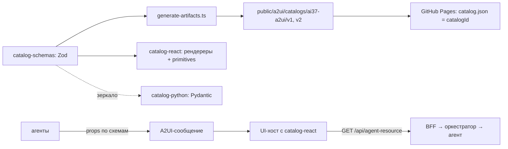

# AI37 A2UI Catalog

<!-- ai37:card:start (managed by doc-bot — do not edit inside) -->
# ai37-a2ui-catalog

## Описание
Монорепозиторий собственного A2UI-каталога AI-37 («AI37 Custom A2UI Catalog»). В нём лежат канонические Zod-схемы компонентов, React-рендереры, Pydantic-модели для валидации на Python, общие фикстуры и тесты. Агенты собирают по этим схемам A2UI-сообщения (формы, редакторы, отчёты расчётов), UI-хосты их рендерят. JSON-артефакты каталога публикуются на GitHub Pages, а их URL служит `catalogId`.

## Стек
- TypeScript 5.9, Node ≥ 22, pnpm ≥ 10 (`packageManager: pnpm@10.29.3`), workspace `packages/*` + `apps/*`.
- Zod 3 + `zod-to-json-schema` (схемы), React 19 + `@a2ui/react`/`@a2ui/web_core` 0.10.1 (зафиксированы через `pnpm.overrides`), `@base-ui/react`, KaTeX (рендереры).
- tsup, tsx, Vite 7, Vitest 4 (jsdom, Testing Library).
- Python ≥ 3.13, Pydantic 2, Poetry, pytest (`packages/catalog-python`).
- Единая синхронная версия пакетов и каталога — 0.44.0.

## Схема работы
- `packages/catalog-schemas` задаёт схемы компонентов и регистрирует их в `catalog.ts`. Константы `CATALOG_ID`, `A2UI_BASE_CATALOG_ID` и `CATALOG_COMPONENT_NAMES` экспортируются отдельно через `./constants`.
- `generate-artifacts.ts` (`pnpm run export:public`) генерирует `catalog.json` и JSON Schema компонентов в `public/a2ui/catalogs/ai37-a2ui/<версия>/`. Текущая версия каталога — `CATALOG_VERSION = 'v2'`, `v1` заморожена.
- `scripts/verify-public.ts` сверяет закоммиченный `public/` с исходником текущей версии и запускается в CI и перед деплоем Pages.
- `packages/catalog-react` даёт рендереры под тот же набор компонентов и примитивы (`./primitives`) для семейства `*Next`.
- `packages/catalog-python` даёт Pydantic-модели (ручное зеркало Zod-схем) и `validate_component_payload` / `validate_component_payload_json` / `get_component_schema`.
- Fetch-подсказки lookup-полей (`suggestMode: 'fetch'`) и рекомендации редактора лифтов ходят same-origin `GET /api/agent-resource?resource=&query=` (`AGENT_RESOURCE_ROUTE` / `LOOKUP_SUGGEST_ROUTE`, ответ `LookupSuggestResponse`). BFF потребителя проксирует запрос в оркестратор.



Компоненты каталога: `SimpleTable`, `FlexTable`, `LatexFormula`, `ChoiceCard`, `AttachmentChoiceCard`, `FormCard`, `ConstructionsEditor(Next)`, `LiftEditor(Next)`, `ThermalReport(Next)`, `KeoEditor(Next)`, `KeoReport(Next)`, `InsolationEditor`, `InsolationReport`, `LiftReport(Next)`, `ArtifactCard`, `VerificationReport`, `ProposalCard`.

## Структура каталогов
- `packages/catalog-schemas/` — `@ai37/a2ui-catalog-schemas`: Zod-схемы (`src/components/`), каталог, константы, генерация артефактов.
- `packages/catalog-react/` — `@ai37/a2ui-catalog-react`: рендереры (`src/renderers/`), примитивы набора (`src/primitives/`).
- `packages/catalog-python/` — Python-пакет `ai37-a2ui-catalog` (`ai37_a2ui_catalog`: `models/`, `validation.py`, `constants.py`).
- `apps/demo/` — `@ai37/a2ui-demo`, Vite-стенд для ручной проверки сообщений (в т.ч. страницы `proba/` системы примитивов, мок-справочники).
- `fixtures/` — `valid/`, `invalid/`, `messages/` (поверхности A2UI) для тестов и демо.
- `tests/` — `ts/`, `react/` (Vitest), `python/` (pytest).
- `public/` — сгенерированные артефакты каталога для GitHub Pages (`a2ui/catalogs/ai37-a2ui/v1`, `v2`).
- `scripts/` — `bump-version.mjs`, `verify-public.ts`, `install-to-consumer.mjs` (установка локальной сборки в потребителя тарболлами), `check-pr-release-metadata.mjs`.
- `docs/` — `theming.md`, `initial-plan.md`; `openspec/changes/` — спецификации изменений компонентов.

## Публичные интерфейсы
- Статический каталог на GitHub Pages: `https://ai-37.github.io/ai37-a2ui-catalog/a2ui/catalogs/ai37-a2ui/v2/catalog.json` (`CATALOG_ID`) и `.../v2/components/*.schema.json`; `v1` хранится рядом.
- npm: `@ai37/a2ui-catalog-schemas` (экспорты `.`, `./constants`), `@ai37/a2ui-catalog-react` (`.`, `./primitives`; peer `react`/`react-dom` ^19).
- PyPI: `ai37-a2ui-catalog`.
- Контракт, который должен реализовать потребитель: same-origin `GET /api/agent-resource?resource=&query=`. Неизвестный resource → 404 `{error: "unknown_resource"}`.
- HTTP-сервиса, A2A, MCP и AG-UI нет.

## Зависимости в экосистеме
### Зависит от
- `@a2ui/react`, `@a2ui/web_core` 0.10.1 (базовый каталог A2UI).
- Приватные реестры `npm.app.sp-ai.ru` и `pypi.app.sp-ai.ru` (публикация; scope `@ai37` закреплён в `.npmrc`).
- В рантайме рендереров: BFF хоста с маршрутом `/api/agent-resource`. Authentik, БД и LLM не используются.

### От него зависят
- spai-ui и UI-форки (рендер), widget-ui.
- spai-chat-backend и форки, `@ai37/agent-host` (ai37-agent-sdk) — `@ai37/a2ui-catalog-schemas`.
- Агенты: spai-elevator-calc-agent, spai-thermal-calc-agent, spai-daylight-factor-calc-agent, spai-consultant-agent, pdai-doc-gen-agent, pdai-site-check, polimetrika-data-agent (по components.md).

## Конфигурация
`.env.example` нет.
- `AI37_NPM_TOKEN` — авторизация в `npm.app.sp-ai.ru`. Через `.npmrc` она нужна уже для `pnpm install`.
- `AI37_PYPI_TOKEN` — пароль публикации в `pypi.app.sp-ai.ru` (CD).
- Переменные организации `CI_RUNNER` / `CD_RUNNER` — выбор раннера.
- Тематизация рендереров — CSS-токены `--a2ui-*` и атрибут `data-a2ui-theme` (см. `docs/theming.md`).

## Данные и хранилища
БД, Redis и S3 нет. Хранятся только статические артефакты в `public/a2ui/catalogs/ai37-a2ui/{v1,v2}` и фикстуры в `fixtures/`.

## Быстрый старт (локально)
```bash
export AI37_NPM_TOKEN=...                       # нужен .npmrc для @ai37
pnpm install
poetry -C packages/catalog-python install
pnpm run demo                                   # Vite-стенд apps/demo
pnpm run build
pnpm run export:public && pnpm run verify:public  # перегенерировать и сверить public/
pnpm run version:bump <version>                 # синхронный бамп версии
pnpm run install:consumer                       # локальная сборка в spai-ui (или: keo teplo …)
```

## Как запускать тесты
```bash
pnpm run test          # vitest run + pytest (tests/python)
pnpm run test:ts       # vitest run tests/ts tests/react
pnpm run test:python   # poetry -C packages/catalog-python run pytest ../../tests/python
pnpm run lint          # = typecheck
```

## Деплой
Не деплоится как сервис.
- `ci.yml` (PR, одна джоба `ci-green`): `pnpm install --frozen-lockfile`, установка Python-пакета, `test:ts`, `test:python`, `build`, `verify:public`.
- `pages.yml`: на push в `main` при изменениях в `packages/catalog-schemas/**` (или вручную) выполняет `verify:public` и деплоит `public/` на GitHub Pages (`https://ai-37.github.io/ai37-a2ui-catalog/`).
- `cd.yml`: по тегу `v*` или вручную (`publish_npm`, `publish_pypi`) сначала переиспользует CI, затем `pnpm publish` обоих npm-пакетов в `https://npm.app.sp-ai.ru/` и `poetry build` + `twine upload` в `https://pypi.app.sp-ai.ru/`.
- Terraform и Helm не используются.

## Связанные документы
- `ecosystem/design/a2ui-negotiation-plan.md` — негоциация MIME → `catalogId` (`CATALOG_ID`, `A2UI_BASE_CATALOG_ID`).
- `ecosystem/v2/10-agui-protocol.md` — AG-UI/A2UI в чате.
- `ecosystem/design/frontend-stack.md`, `ecosystem/design/ui-principles-sp-ai.md` — фронтенд-основа.
- `docs/theming.md` (в репозитории).
<!-- ai37:card:end -->

<!-- Ниже — только уникальный человеческий контекст (замысел, инварианты, грабли).
     Не дублируйте сюда «что/как» из карточки выше — её ведёт docs-bot из кода. -->

## Тема семейства `*Next`

Тему компонентов на наборе примитивов (`ConstructionsEditorNext`, `LiftEditorNext`,
`ThermalReportNext`, `LiftReportNext`) выбирает **хост**, а не компонент: в схемах и в
контракте A2UI темы нет. Каждый цветной токен набора несёт обе половины одним
значением — `light-dark(<светлое>, <тёмное>)`, — а какая половина читается, решает
наследуемое свойство `color-scheme`.

Три способа сказать своё слово, от знакомого к прямому:

```html
<!-- 1. Атрибут набора — на контейнере сообщения или на самом корне компонента -->
<div data-a2ui-theme="dark"><A2uiSurface … /></div>
```

```css
/* 2. Прямой color-scheme — если он у вас уже объявлен (next-themes, .dark и т.п.),
      делать не нужно ничего: набор возьмёт тему по наследованию. */
.dark { color-scheme: dark; }

/* 3. «Следовать системе» — осознанный шаг хоста, а не поведение по умолчанию. */
.chat { color-scheme: light dark; }
```

**Без слова хоста набор светлый** — даже при тёмной ОС. Это выбор: компонент живёт
внутри чужой ленты, и карточка, потемневшая сама по себе в светлом чате, — такой же
дефект, как светлая карточка в тёмном. Правду о теме знает поверхность.

Попап (справочник, список, меню) уезжает в портал, где предка с темой нет, — схему ему
доносит примитив от якоря. Если монтируете попап мимо примитивов каталога, тему
придётся донести самим.

Палитру можно переопределить, объявив токен `--a2ui-*` **на том же элементе `.a2ui-kit`
или ниже**: на предке не сработает — там объявление набора сильнее. Старые рендереры
живут на других токенах (`--a2ui-color-*`), их темизация описана в `docs/theming.md`.

## Adding Components

1. Add the canonical Zod schema in `packages/catalog-schemas/src/components/<component>.ts`.
2. Export the new definition from `packages/catalog-schemas/src/index.ts` and register it in `packages/catalog-schemas/src/catalog.ts` so it appears in `componentDefinitions` and the exported catalog artifact.
3. Add the React renderer in `packages/catalog-react/src/renderers/<component>.tsx` and register it from `packages/catalog-react/src/catalog.ts`.
4. Add the manual Pydantic model in `packages/catalog-python/src/ai37_a2ui_catalog/models/<component>.py`, then export it from `packages/catalog-python/src/ai37_a2ui_catalog/models/__init__.py` and `packages/catalog-python/src/ai37_a2ui_catalog/__init__.py` when it is part of the public API.
5. Add or update fixtures in `fixtures/messages` so the new component has realistic surface messages for tests and local verification.
6. Run `pnpm run test`, `pnpm run build`, and if you changed exported schemas also run `pnpm run export:schemas -- --output ./tmp/catalog-public`.

## Versioning

The repository uses a synchronized version for npm packages, the Python package, and the catalog artifacts. Use `pnpm run version:bump <version>` to update the tracked manifest versions in one pass.

Every pull request is expected to do two release bookkeeping updates together with the code change:

- bump the synchronized version before merge
- add a matching entry to `CHANGELOG.md` using the heading format `## [x.y.z] - YYYY-MM-DD`
